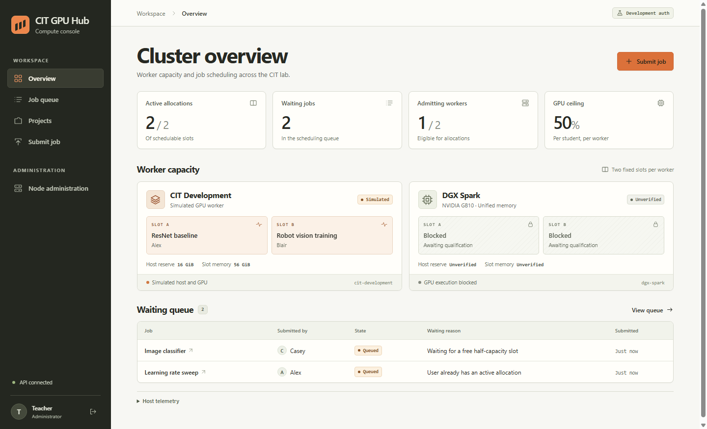
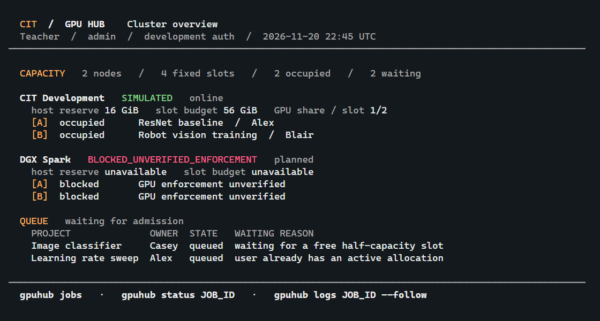

# CIT GPU Hub

A classroom job queue with two fixed half-capacity slots per worker, a browser console, and a terminal client. Each student can hold one active allocation across the hub. An idle slot stays available for the next eligible student.

## Run the development hub

Use Python 3.11 or newer. From the repository root, create and activate a virtual environment, then run:

```sh
python -m pip install -r requirements.lock
python -m pip install -e ".[cli,test]"
python -m deploy.dev --demo
```

Open **http://127.0.0.1:8765** and choose the local teacher identity for a class-wide view. The demo creates four submissions across three student accounts. Two occupy the simulated worker, one waits for a slot, and one waits for its owner’s existing allocation. The Spark appears as an unqualified hardware target. Example attempts advance on a timer; this mode never executes uploaded Python. Use a new `--state` directory to run a fresh demonstration.

## Terminal

```sh
gpuhub login --identity teacher
gpuhub dashboard
gpuhub jobs
gpuhub status JOB_ID
gpuhub logs JOB_ID --follow
gpuhub cancel JOB_ID
gpuhub resume JOB_ID --checkpoint CHECKPOINT_ID
gpuhub download JOB_ID --output ./results
```

## Validation and operations

```sh
python -m pytest
python -m services.worker probe
```

The development test run on November 20, 2026 passed 81 tests and skipped six. Two require native Linux Docker, two require school GPU qualification, and two require filesystem features unavailable in the Windows test environment. Browser and terminal checks exercised the real API through a local in-process transport with the simulated worker. The next milestone is the three-student CPU-container workflow and hard-limit tests on an idle native Linux host.

See [architecture](docs/architecture.md), [decisions](docs/decisions.md), [resource policy](docs/resource-policy.md), [student quick start](docs/student.md), [teacher operations](docs/operations.md), [security](docs/security.md), and the [hardware qualification procedure](docs/qualification.md).

## Interface captures





Both captures show the same local development workflow. Physical GPU qualification and the school pilot require access to the target machines.
