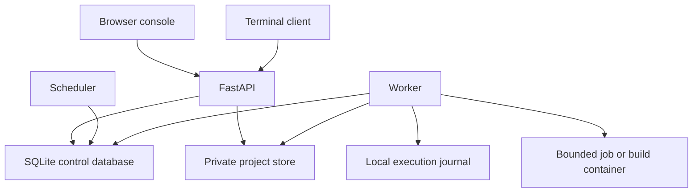

# GPU Hub architecture

The browser and terminal submit the same versioned manifest to FastAPI. The API authenticates the principal, verifies project and dataset access, and stores source and intent. Only the worker can invoke Docker. This release runs the API, scheduler and worker as separate processes on a single trusted host.

## One submission through the system

1. The owner uploads a Python file or ZIP into a project. The API records the validated manifest and immutable revision and checks catalog access again when the job is submitted.
2. The scheduler serializes admission within a database transaction. It applies fairness and qualification, creates an attempt, and reserves one slot. Unique constraints exclude a second active reservation for either the same principal or the same slot.
3. The worker consumes the durable launch identity, records intent in its journal and starts the selected backend. Replayed commands reconcile against journal entries and container labels. Native containers verify cgroup settings before invoking student code.
4. The worker records process start, the absolute deadline, available observations, cursor-addressable logs, and stop evidence. A missing heartbeat marks the attempt uncertain. The controller holds its reservation until termination has been established.
5. After exit the worker collects bounded outputs and valid checkpoints. Authorized clients download published artifacts by opaque ID. An explicit resume points a new attempt at a completed checkpoint compatible with its source, environment and datasets.

## Code map

| Directory | Responsibility |
| --- | --- |
| `apps/web`, `apps/cli` | Offline-loadable dashboard and terminal client |
| `services/api` | HTTP contract and OpenAPI schema, catalog authorization, source ingestion and private downloads |
| `services/scheduler` | SQL migrations, deterministic dispatch, per-principal and per-slot accounting |
| `services/worker` | Native worker loop, journal, watchdog, stop and collection |
| `packages/resource_policy`, `packages/observability` | Immutable envelopes, node inventory, cgroup observations and fingerprints |
| `packages/contracts`, `packages/runner_sdk` | Manifest, storage quotas, retention, cooperative checkpoint publication and resume |
| `packages/execution_backends` | Docker control, offline dependency builds, hardware-specific admission and teardown |
| `examples`, `tests` | Executable CPU projects and independent policy, integration and hardware tests |

Read-only discovery, simulated execution and physical qualification are separate operations. A registered future Spark can appear in the dashboard with two blocked slots and no measured memory inventory. The overview uses status and timestamp metadata for observations; the worker-local limits operate without the dashboard.

## Deployment boundary

SQLite WAL, source revisions, journals, immutable outputs and cache directories belong on the worker host. Run the processes under trusted service identities with the state tree closed to student logins. The current service-to-service boundary is local OS access to that tree. Adding a second physical host requires an authenticated worker transport and authorized, hash-verified data staging or shared object storage. Copying the WAL database onto a network share is outside this deployment model.

Consult the [resource policy](resource-policy.md), [teacher operations](operations.md), [storage lifecycle](storage-and-checkpoints.md), and [hardware qualification](qualification.md).
